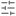

# Guía de usuario de Pixban

Pixban permite pixelar partes de una imagen y añadir texto desde el navegador. Puedes probar las herramientas con **Probar con una imagen de ejemplo**.

## Abrir una imagen

Pixban admite imágenes **PNG, JPEG y WebP** de hasta **32 megapíxeles**.

-  Usa **Abrir imagen** para elegir un archivo o arrástralo a cualquier parte de la ventana del editor.
-  Usa **Pegar imagen** para abrir una imagen del portapapeles. Si el navegador bloquea el botón, prueba `Ctrl/⌘+V` en el editor o abre el archivo directamente.

## Herramientas de edición

-  **Seleccionar** (`V`). Selecciona una edición. Arrastra un rectángulo o un texto para moverlo. Arrastra las esquinas de un rectángulo para cambiar su tamaño. Haz clic en un texto para editarlo.
-  **Desplazar** (`H`). Arrastra para mover la vista. Mantén pulsado `Espacio` y arrastra para desplazarla temporalmente mientras usas otra herramienta.
-  **Rectángulo pixelado** (`R`). Arrastra sobre el área que quieres pixelar.
-  **Pincel de pixelado** (`B`). Pinta sobre los detalles que quieres pixelar.
-  **Texto** (`T`). Haz clic para añadir o editar texto. Pulsa `Intro` para insertar otra línea. Pulsa `Ctrl/⌘+Intro` o haz clic fuera para guardar. Pulsa `Esc` para cancelar la edición en curso.

## Ajustes e historial

-  En **Ajustes de herramienta**, configura la herramienta activa o la edición seleccionada. El **Tamaño del bloque** va de 4 a 25 px para rectángulos y trazos. El **Diámetro del pincel** va de 8 a 50 px y se aplica a los trazos nuevos. Para el texto, ajusta el **Tamaño de letra** (8–256 px) y el **Color del texto**.
-  **Ediciones** muestra los cambios. Selecciona una entrada para ajustarla, usa  **Eliminar edición** para quitarla o pulsa  **Eliminar todo** y confirma para quitar todas las ediciones. En móvil, **Ajustes** y **Ediciones** se abren desde la barra de herramientas.
-  Usa **Deshacer** con `Ctrl/⌘+Z`.  Usa **Rehacer** con `Ctrl/⌘+Mayús+Z` o `Ctrl/⌘+Y`.
- Usa los controles de zoom o pulsa  **Ajustar a la ventana**. En escritorio también puedes introducir directamente un porcentaje de zoom.
- Usa   **Cambiar tema de color** para alternar entre el modo claro y el oscuro. Elige **EN** o **ES** en el encabezado para cambiar el idioma de la interfaz.

## Exportar y compartir

-  **Exportar** abre el selector de formato. Pixban selecciona inicialmente el formato original. Elige **PNG** o **WebP** para conservar la transparencia, o **JPEG** para usar un fondo blanco. Pulsa **Descargar imagen** para guardar una copia. Si el navegador no admite el formato elegido, Pixban descarga un PNG.
-  **Copiar al portapapeles** copia la imagen editada como PNG. Si el portapapeles no está disponible, usa **Exportar** para descargar un archivo.

Las dos opciones mantienen la resolución original e integran el pixelado y el texto en la copia. El archivo original se conserva intacto.

## Privacidad y seguridad

 Pixban procesa las imágenes en tu navegador sin subirlas a un servidor ni pedirte una cuenta. La imagen y el historial de edición se mantienen durante la sesión y se pierden al recargar o cerrar la página. Exporta una copia antes de salir si quieres conservar tu trabajo.

El pixelado oculta detalles visualmente. La información sensible puede seguir siendo reconocible, así que revisa la imagen exportada antes de compartirla.
