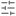

# Pixban user guide

Pixban lets you pixelate parts of an image and add text in your browser. You can try the tools with **Try a sample image**.

## Open an image

Pixban accepts **PNG, JPEG and WebP** images up to **32 megapixels**.

-  **Open image** to choose a file, or drag a file anywhere in the editor window.
-  **Paste image** to open an image from the clipboard. If the browser blocks the button, try `Ctrl/⌘+V` in the editor or open the file directly.

## Editing tools

-  **Select** (`V`). Select an edit. Drag a rectangle or text to move it. Drag a rectangle's corner handles to resize it. Click existing text to edit it.
-  **Pan** (`H`). Drag to move the view. Hold `Space` and drag to pan temporarily while using another tool.
-  **Pixelated rectangle** (`R`). Drag across the area you want to pixelate.
-  **Pixelated brush** (`B`). Paint over the details you want to pixelate.
-  **Text** (`T`). Click to add or edit text. Press `Enter` for a new line. Press `Ctrl/⌘+Enter` or click outside to save. Press `Esc` to cancel the current edit.

## Settings and history

-  Use **Tool settings** to configure the active tool or selected edit. **Block size** ranges from 4 to 25 px for rectangles and brush strokes. **Brush diameter** ranges from 8 to 50 px and applies to new strokes. For text, set **Font size** (8–256 px) and **Text color**.
-  **Edits** lists your changes. Select an entry to adjust it, use  **Delete edit** to remove it, or choose  **Clear all** to remove all edits after confirming. On mobile, **Settings** and **Edits** open from the toolbar.
-  **Undo** with `Ctrl/⌘+Z`.  **Redo** with `Ctrl/⌘+Shift+Z` or `Ctrl/⌘+Y`.
- Use the zoom controls or choose  **Fit to view**. On desktop, you can also enter a zoom percentage directly.
- Use   **Toggle color theme** to switch between light and dark mode. Choose **EN** or **ES** in the header to change the interface language.

## Export and share

-  **Export** opens the format picker. Pixban initially selects the source format. Choose **PNG** or **WebP** to preserve transparency, or **JPEG** for a white background. Choose **Download image** to save a copy. If the browser does not support the selected format, Pixban downloads a PNG instead.
-  **Copy to clipboard** copies the edited image as PNG. If clipboard access is unavailable, use **Export** to download a file.

Both options keep the original resolution and flatten pixelation and text into the copy. Your original file stays intact.

## Privacy and security

 Pixban processes images locally in your browser without uploading them or requiring an account. The image and edit history are held for the current session and are lost when you reload or close the page. Export a copy before leaving if you want to keep your work.

Pixelation obscures details visually. Sensitive information can still be recognizable, so check the exported image before sharing it.
